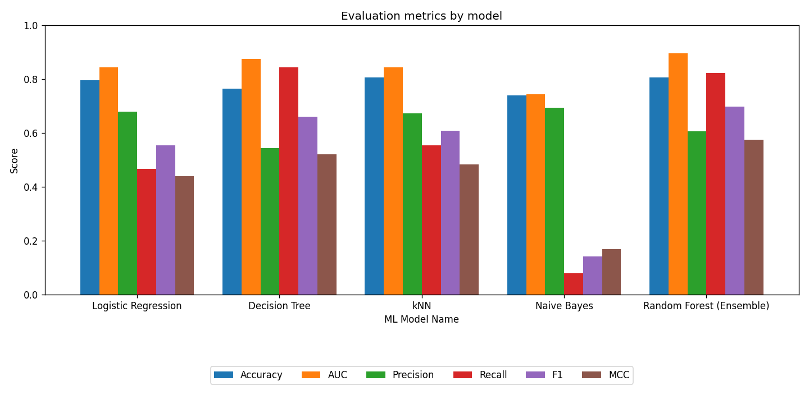
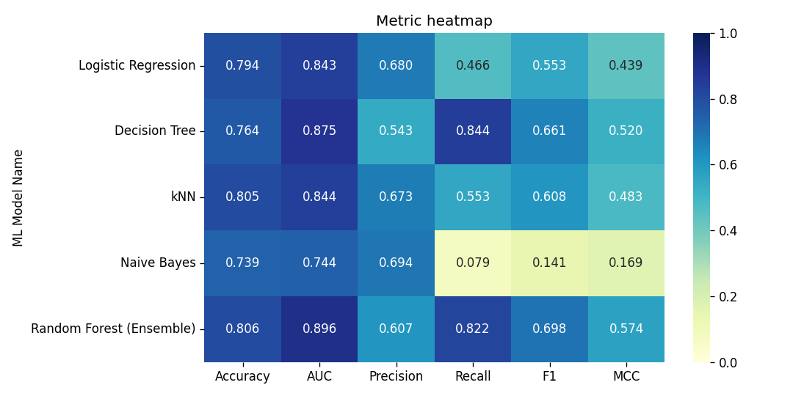

# Hotel Booking Cancellation Prediction - ML Assignment 2

## Problem Statement
Hotels lose money when people cancel their bookings, especially at the last minute. In this assignment I try to predict whether a booking will get canceled (`is_canceled = 1`) or not (`is_canceled = 0`) using the booking details. I trained five classification models on the same data and compared them.

## Dataset Description
- **Source:** Kaggle - [Hotel Booking Demand](https://www.kaggle.com/datasets/jessemostipak/hotel-booking-demand) (`hotel_bookings.csv`, originally from Antonio, Almeida & Nunes, *Data in Brief*, 2019).
- **Size:** 119,390 instances, 32 columns (31 features + target).
- **Target:** `is_canceled` (binary).
- **Why this dataset:** It is a real-world problem and it is big enough (more than 1,000 rows and 12 features). It has both numeric and categorical columns, some missing values, a lot of duplicate rows and the classes are not balanced. So I could actually do all the preprocessing steps asked in the assignment.
- **Feature types:**
  - Numeric (19): `lead_time`, `arrival_date_year`, `arrival_date_week_number`, `arrival_date_day_of_month`, `stays_in_weekend_nights`, `stays_in_week_nights`, `adults`, `children`, `babies`, `is_repeated_guest`, `previous_cancellations`, `previous_bookings_not_canceled`, `booking_changes`, `agent`, `company`, `days_in_waiting_list`, `adr`, `required_car_parking_spaces`, `total_of_special_requests`
  - Categorical (12): `hotel`, `arrival_date_month`, `meal`, `country`, `market_segment`, `distribution_channel`, `reserved_room_type`, `assigned_room_type`, `deposit_type`, `customer_type`, `reservation_status`, `reservation_status_date`
- **Class distribution:** In the raw data, 62.96% bookings are not canceled and 37.04% are canceled. After removing duplicates it became 72.72% / 27.28%, so the data is somewhat imbalanced.

### Preprocessing
| Step | Action |
|---|---|
| Missing values | `company` (94.3% missing) and `agent` (13.7% missing) are mostly empty, so I changed them to yes/no columns `has_company` and `has_agent`. `children` (4 missing) is filled with the median and `country` (488 missing) with the most common value. |
| Leakage | Dropped `reservation_status` and `reservation_status_date`. These are filled after the booking is canceled or checked out, so they basically give away the answer. |
| Duplicates | Removed 32,270 duplicate rows, which left 87,120 rows. |
| Train-test split | 80:20 split with `stratify` on `is_canceled` and `random_state=42`. Train has 69,696 rows and test has 17,424 rows, both with the same 72.7 / 27.3 class ratio. |
| Country column | `country` has too many values, so I kept the top 15 countries (from train) and put the rest as `Other`. |
| Encoding | One-hot encoding for the categorical columns. |
| Scaling | StandardScaler for the numeric columns. |
| Final feature count | 96 |

The imputers, encoder and scaler are fitted only on the training data and then used on the test data, so no test information leaks into training.

## GitHub Repository Link
https://github.com/2026ct05084-del/Assignment-_2_Ml

### How to run
```bash
pip install -r requirements.txt
cd model
# run the notebooks in order 00 -> 06 (Jupyter / VS Code), or:
jupyter nbconvert --to notebook --execute --inplace 00_eda_preprocessing.ipynb
jupyter nbconvert --to notebook --execute --inplace 01_logistic_regression.ipynb
jupyter nbconvert --to notebook --execute --inplace 02_decision_tree.ipynb
jupyter nbconvert --to notebook --execute --inplace 03_knn.ipynb
jupyter nbconvert --to notebook --execute --inplace 04_naive_bayes.ipynb
jupyter nbconvert --to notebook --execute --inplace 05_random_forest.ipynb
jupyter nbconvert --to notebook --execute --inplace 06_comparison.ipynb
```
`knn.joblib` and `random_forest.joblib` are not committed (size); running notebooks 03 and 05 regenerates them.

## Models Used

### Model configurations
| Model | Configuration |
|---|---|
| Logistic Regression | `C=1.0`, L2, `lbfgs`, `max_iter=1000`, no class weighting (baseline) |
| Decision Tree | `gini`, `max_depth=12`, `min_samples_leaf=20`, `class_weight='balanced'` |
| kNN | `n_neighbors=15`, `weights='distance'`, Euclidean (no class-weight option) |
| Naive Bayes | `GaussianNB` (default `var_smoothing`); Gaussian chosen because scaled features can be negative |
| Random Forest (Ensemble) | `n_estimators=300`, `max_depth=20`, `min_samples_leaf=5`, `class_weight='balanced'` |

All use `random_state=42` where applicable and the same preprocessor.

### Comparison Table
| ML Model Name | Accuracy | AUC | Precision | Recall | F1 | MCC |
|---|---|---|---|---|---|---|
| Logistic Regression | 0.7945 | 0.8431 | 0.6798 | 0.4663 | 0.5532 | 0.4385 |
| Decision Tree | 0.7636 | 0.8755 | 0.5428 | 0.8441 | 0.6607 | 0.5204 |
| kNN | 0.8050 | 0.8435 | 0.6733 | 0.5535 | 0.6075 | 0.4835 |
| Naive Bayes | 0.7393 | 0.7435 | 0.6939 | 0.0787 | 0.1414 | 0.1690 |
| Random Forest (Ensemble) | **0.8061** | **0.8956** | 0.6066 | 0.8220 | **0.6981** | **0.5740** |

Precision, Recall and F1 are reported for the positive class (canceled = 1).

### Visualisation




### Observations
| ML Model Name | Observation about model performance |
|---|---|
| Logistic Regression | Accuracy (0.79) and AUC (0.84) are decent, but recall is only 0.47, so it misses more than half of the canceled bookings. I did not use class weights here, so it leans towards the "not canceled" class. |
| Decision Tree | With `class_weight='balanced'` the recall went up to 0.84, which is the highest of all models. But precision dropped to 0.54, so it also marks many normal bookings as canceled. |
| kNN | Accuracy is 0.805 and F1 and MCC are better than Logistic Regression. Recall is still only 0.55 because kNN has no class weight option. It was also the slowest model to predict. |
| Naive Bayes | This was the worst model. Recall is only 0.08, so it almost never predicts "canceled". Accuracy of 0.74 looks okay but it is close to just guessing the majority class, and the MCC of 0.17 shows it. |
| Random Forest (Ensemble) | This gave the best Accuracy (0.806), AUC (0.896), F1 (0.698) and MCC (0.574). Recall is high (0.82) and precision is better than the single Decision Tree. |

### Overall Winner
**Random Forest (Ensemble)**, because it got the best scores on Accuracy, AUC, F1 and MCC. It catches most of the cancellations without too many wrong alarms.

## BITS Virtual Lab Execution
`<ATTACH SCREENSHOT HERE>`
